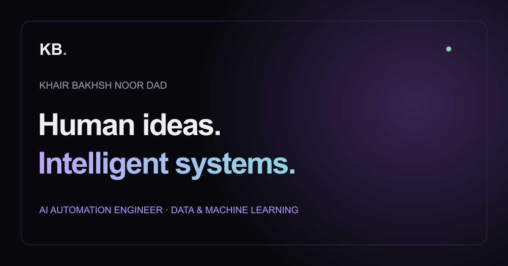



  
  <h1>Khair Bakhsh Noor Dad</h1>
  
<strong>AI Automation Engineer · Chatbots & Voice Agents · Data & Machine Learning</strong>

  
Karachi, Pakistan

  

    <a href="https://github.com/khairbakshnoor-pixel">GitHub</a>
    &nbsp;·&nbsp;
    <a href="https://linkedin.com/in/khair-bakhsh-54714b339">LinkedIn</a>
    &nbsp;·&nbsp;
    <a href="mailto:khairbakshnoor@gmail.com">Email</a>
  

---

## What I do

I build voice and chat assistants, connect business tools with automation, and use data to make workflows easier to understand. My work combines conversation design, APIs, CRM systems, retrieval, and practical machine learning.

I care about clear handoffs, grounded answers, and tools that are useful to the people using them.

## Selected work

| Project | What I built |
| --- | --- |
| **Wellness lead response agent** | A Retell AI voice workflow connected to web forms, n8n, a CRM, booking functions, and team handoffs. Tested with mock calls. |
| **Client onboarding assistant** | A chat and voice experience that gathers 13 business fields and routes them into CRM and team tools. |
| **Customer churn dashboard** | A Streamlit app comparing six models across 7,043 Telco customer records. The project brief reports 80.6% accuracy and 0.84 ROC-AUC for Gradient Boosting. |
| **Roman Urdu catering assistant** | A chat and voice assistant that uses booking details already provided and asks only for missing information. |
| **Engineering project assistant** | A website chatbot that helps visitors explore engineering services and start a project conversation. |
| **Crypto analytics dashboard** | A CoinGecko-to-SQLite snapshot pipeline with a Streamlit dashboard and update-failure handling. |

Explore the [portfolio source](khair-portfolio/) for full case studies, project demos, technologies, and the searchable GitHub catalog.

## Experience

- **AI Automation Engineer — AI Call** · Jul 2026–Present  
  Voice agents, n8n workflows, CRM integrations, and knowledge-grounded chatbots.
- **Data Analyst — Hot-N-Spicy** · Mar 2026–Jun 2026  
  Transaction data analysis, operational KPIs, and Python/Excel reporting.
- **AI/ML Intern — Alkhidmat Foundation** · Nov 2025–Feb 2026  
  Data preparation, model evaluation, and communicating analytical findings.

## Toolkit

**Automation:** n8n, Retell AI, GoHighLevel, HubSpot, webhooks, REST APIs  
**AI:** RAG, Supabase pgvector, Ollama, Claude API, prompt and conversation design  
**Data & ML:** Python, Pandas, NumPy, scikit-learn, TensorFlow, Streamlit, Plotly  
**Development:** JavaScript, SQL, Java, C/C++, Git, GitHub

## Education

**BS Computer Science** — SZABIST University, Karachi  
CGPA: 3.66

Training includes AI & Data Science, Data Analysis with Python, Python Programming, and Web Development.

## Build this portfolio locally

The complete website is in the khair-portfolio directory. It uses Next.js, TypeScript, Tailwind CSS 4, and Framer Motion.

    cd khair-portfolio
    corepack enable
    pnpm install --frozen-lockfile
    pnpm dev

The portfolio is intentionally portrait-free. Its project cards focus on the work, stack, and outcomes; the banner above uses the site’s own typographic artwork.

---

  Thoughtfully built. Always evolving.

