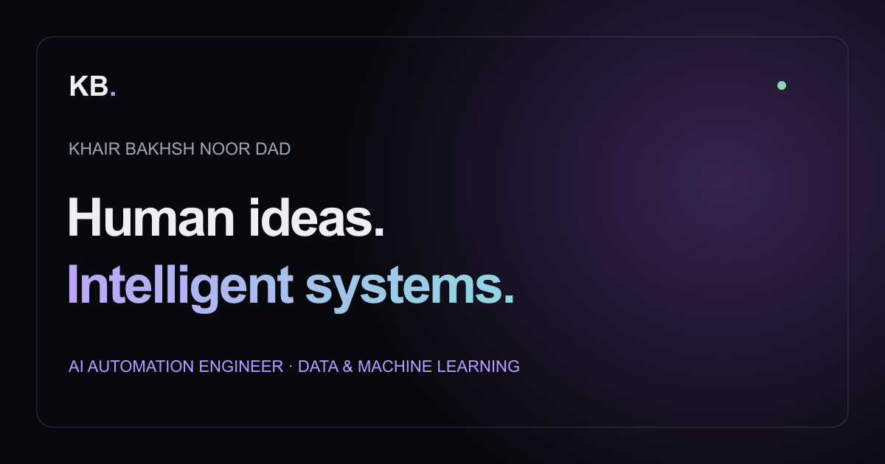

  
  <h1>Khair Bakhsh · Portfolio</h1>
  
<strong>AI automation · Voice agents · Chatbots · Data & machine learning</strong>

  
Portrait-free, content-led portfolio built with Next.js and TypeScript.

  
<a href="https://github.com/khairbakshnoor-pixel">GitHub</a> · <a href="https://linkedin.com/in/khair-bakhsh-54714b339">LinkedIn</a> · <a href="mailto:khairbakshnoor@gmail.com">Email</a>

---

## What I do

I build voice and chat assistants, connect business tools with automation, and use data to make workflows easier to understand. I care about clear handoffs, grounded answers, and tools that are useful to the people using them.

## Selected work

| Project | What I built |
| --- | --- |
| **Wellness lead response agent** | Retell AI voice workflow connected to web forms, n8n, CRM, booking functions, and team handoffs. Tested with mock calls. |
| **Client onboarding assistant** | Chat and voice experience that gathers 13 business fields and routes them into CRM and team tools. |
| **Customer churn dashboard** | Streamlit app comparing six models across 7,043 Telco records. The project brief reports 80.6% accuracy and 0.84 ROC-AUC for Gradient Boosting. |
| **Roman Urdu catering assistant** | Chat and voice assistant that uses booking details already provided and asks only for missing information. |
| **Engineering project assistant** | Website chatbot that helps visitors explore engineering services and start a project conversation. |
| **Crypto analytics dashboard** | CoinGecko-to-SQLite snapshot pipeline with a Streamlit dashboard and update-failure handling. |

## Experience

- **AI Automation Engineer — AI Call** · Jul 2026–Present
- **Data Analyst — Hot-N-Spicy** · Mar 2026–Jun 2026
- **AI/ML Intern — Alkhidmat Foundation** · Nov 2025–Feb 2026

## Toolkit

- **Automation:** n8n, Retell AI, GoHighLevel, HubSpot, webhooks, REST APIs
- **AI:** RAG, Supabase pgvector, Ollama, Claude API, prompt and conversation design
- **Data & ML:** Python, Pandas, NumPy, scikit-learn, TensorFlow, Streamlit, Plotly
- **Development:** JavaScript, SQL, Java, C/C++, Git, GitHub

## Education

**BS Computer Science** — SZABIST University, Karachi · CGPA 3.66

---

## Run locally

Requirements: Node.js 22 or newer and pnpm 10.28.2.

    corepack enable
    pnpm install --frozen-lockfile
    pnpm dev

Open the localhost address printed by Next.js.

Useful project commands:

    pnpm lint
    pnpm typecheck
    pnpm build
    pnpm start

No API keys are needed. The contact form opens a prefilled email draft in the visitor’s email application; it does not send or store messages.

## Portfolio content

Edit src/data/portfolio.ts to update the identity, navigation, work history, case studies, skills, education, repository links, contact copy, and social links.

- Eight of 17 case studies appear first. “Explore all projects” reveals the full collection.
- Category filters include every relevant project, including projects outside the initial selection.
- Chatbot case studies have their own section and category filter.
- Case studies describe the challenge, what was built, the outcome, and the technology used.
- Live project links appear on cards when a verified demo URL is available.
- GitHub highlights are a reviewed snapshot so the portfolio works when GitHub is unavailable.
- Client names and identifying links stay private unless explicitly approved.

## Visual direction

The site uses a text-first hero and project cards instead of profile photography or generated project illustrations. Direct project names, concise descriptions, technology labels, and case-study details keep the focus on the work.

Edit src/app/globals.css for layout, colors, typography, spacing, and responsive behavior. The design includes dark and light themes, keyboard focus styles, a responsive navigation menu, and reduced-motion support.

Self-hosted Inter and Space Grotesk font files and their OFL licenses are in public/fonts.

## CV

public/cv.pdf is a placeholder. Replace it with an approved CV and set cv.available to true in src/data/portfolio.ts to enable the download link. Until then, the footer offers a CV request by email.

## Deploy to Vercel

1. Push this project directory to a GitHub repository.
2. Import it in Vercel and keep the detected Next.js preset.
3. Set NEXT_PUBLIC_SITE_URL to the final HTTPS origin, without a trailing slash.
4. Deploy. No environment secrets are required.

Static export is also supported:

    $env:STATIC_EXPORT = "1"
    pnpm build
    python -m http.server 3000 --bind 127.0.0.1 --directory out

For macOS or Linux, run the build with STATIC_EXPORT=1 in the environment. The generated site is written to out/.

## Project structure

    src/app/                 Page, metadata, styling, robots, sitemap, 404
    src/components/          Portfolio interface and SVG icons
    src/data/portfolio.ts    Editable portfolio content and repository catalog
    public/fonts/            Self-hosted font files and licenses
    public/og-image.png      Social sharing artwork; contains no portrait
    public/cv.pdf            Placeholder until an approved CV is supplied

## Before publishing

- Replace the CV placeholder and enable the download link.
- Confirm any client-facing links before adding them.
- Recheck the customer churn demo before restoring its link.
- Update current role, semester, and availability details as they change.
- Set the production domain in NEXT_PUBLIC_SITE_URL.
- Connect a real form service only if desired; keep credentials server-side.
